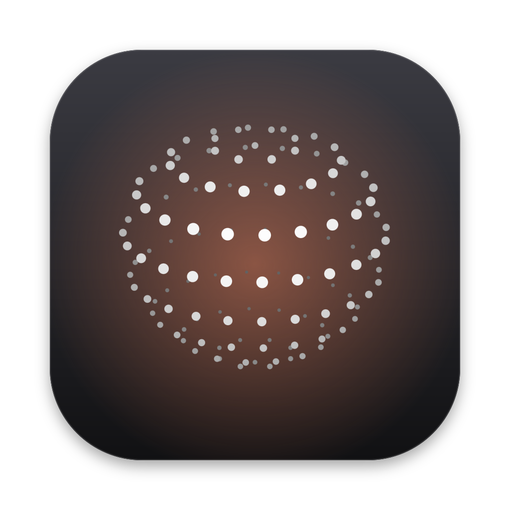
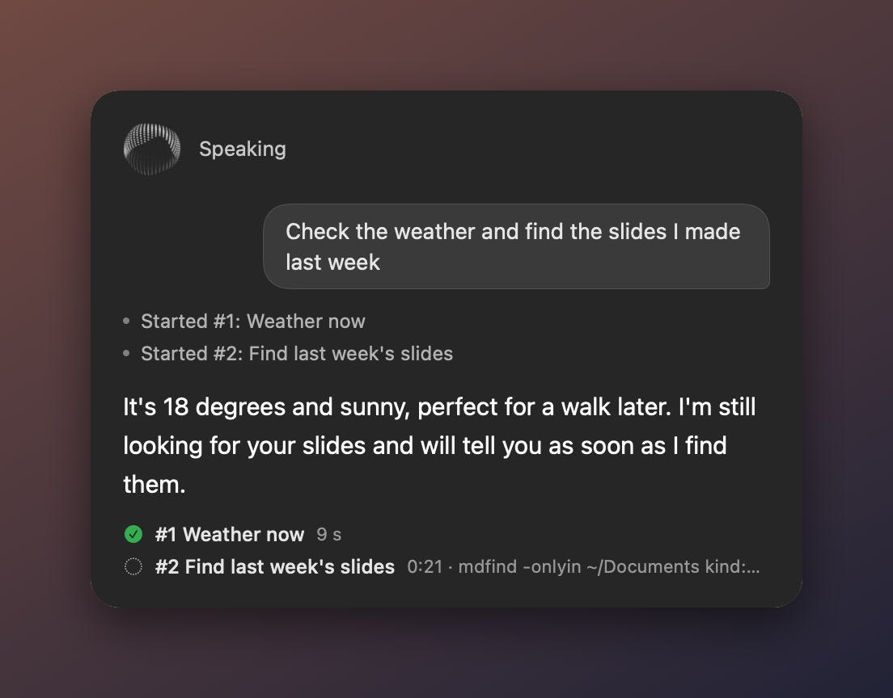

<p align="center"></p>

<h1 align="center">Otto</h1>

<p align="center"><b>Say “Hey Otto”. A voice assistant for your Mac, powered by Claude Code.</b></p>

<p align="center">
  <a href="https://github.com/jimjja/hey-otto/actions/workflows/ci.yml"></a>
  
  
  <a href="LICENSE"></a>
</p>

<p align="center"><a href="https://github.com/jimjja/hey-otto/releases/latest/download/Otto.zip"></a></p>

<p align="center"></p>

Say “Hey Otto” and ask for anything. A fast voice answers right away and hands the real work to Claude Code agents running in the background, several at once. They use your shell, your apps, your browser and your files, and Otto keeps talking with you while they work.

- **Talks while it works.** “Check the weather and find the slides I made last week”: Otto replies in about two seconds, starts two background tasks, and tells you each result as it lands.
- **You stay in charge of the agents.** Ask “how's the slides one going?”, “also check tomorrow” or “cancel the report”. Tasks show in the panel and the menu bar.
- **Interrupt it naturally.** Talk over it and it stops. Echo cancellation keeps it from hearing itself.
- **Knows what you're looking at.** Say “summarize this” and the front window's text goes along. Press both ⌘ keys to attach a window, text and picture.
- **Knows your Claude work.** It can look through your Claude Cowork and Claude Code sessions on this Mac when you ask what you were doing.
- **Your voice stays on your Mac.** Speech recognition and the voice run on-device. No telemetry, no auto-update.

Otto is an independent project. It isn't made by or affiliated with Anthropic.

## Requirements

- macOS 14 or later, and Apple's command line tools (`xcode-select --install`).
- [Claude Code](https://claude.com/claude-code), installed and signed in.
- Optional: the [Claude in Chrome](https://code.claude.com/docs/en/chrome) extension (Chrome, Brave or Edge), so tasks can use your browser where you're already signed in.

## Install

```bash
git clone https://github.com/jimjja/hey-otto.git
cd hey-otto
./build.sh
```

What the build does:
1. It builds `~/Applications/Otto.app` from source and starts it.
2. The first time, it creates a local code-signing identity, so macOS remembers Otto's permissions across rebuilds. macOS asks once to let `codesign` use it: click **Always Allow**.

When Otto first starts:
1. Allow **Microphone** and **Speech Recognition**.
2. Open menu bar icon → **Permissions…** and allow **Accessibility** (reading windows, typing, clicking) and **Screen Recording** (screenshots).
3. For on-device speech, turn on Dictation once in System Settings → Keyboard, which downloads Apple's speech model.

To update: `git pull && ./build.sh`.

**Or download the latest build:** **[Otto.zip](https://github.com/jimjja/hey-otto/releases/latest/download/Otto.zip)**. It's rebuilt automatically from `main` after every change that passes the tests ([release page](https://github.com/jimjja/hey-otto/releases/tag/latest-build)). Building from source is still the better way:
- **Gatekeeper blocks it.** These builds aren't signed or notarized by Apple, so macOS refuses a downloaded copy until you clear the download flag:
  ```bash
  cd ~/Downloads && unzip -q Otto.zip && xattr -dr com.apple.quarantine Otto.app && mv Otto.app ~/Applications/ && open ~/Applications/Otto.app
  ```
- **Permissions don't carry over.** Each build is signed differently, so macOS asks for its permissions again after every update.

## Use

| Say or do | What happens |
|---|---|
| “Hey Otto, what's on my calendar tomorrow?” | Speak in one breath, or say “Hey Otto”, wait for the chime, then speak. |
| (stay quiet after an answer) | Otto listens for about 7 s for a follow-up, with no wake word needed. |
| (talk while it's speaking) | It pauses, listens, and takes what you say as the next request. |
| “Hey Otto, stop” | Stops talking and the current reply. Background tasks keep running. |
| “how's the … going?” · “also …” · “cancel …” | Check on, steer or cancel a background task. Up to 5 run at once (menu → Tasks → Parallel Tasks); more wait in a queue. |
| “summarize this” · “reply to this email” | The front window's text goes along with the request. |
| Both ⌘ keys | Attach the front window (text and picture), then say what to do with it. |
| ⌃⌥Space | Talk without the wake word. Press again to send right away. |
| “Hey Otto, new conversation” | Start fresh. This also happens on its own after 15 minutes idle. |

**Menu bar:**
- Settings: wake word, voice, model, pause length, safety, echo cancellation, open at login.
- Tasks: with Cancel for each.
- Type a request, and the log.

**A better voice:** Otto reads answers in your Mac's System Voice. For a natural one, pick a Siri or Premium voice in System Settings → Accessibility → Spoken Content → System Voice (free downloads).

## Safety

Otto's agents can do anything you can do on your Mac. Anything an agent *reads*, such as a web page, an email or a document, can contain instructions written to manipulate it. Speech can also be misheard. So by default Otto runs in **Ask Before Risky Actions** mode:

- **Routine actions run without asking.** Claude Code's own judgment (its auto mode) checks every action against what you actually asked for.
- **Out-of-place actions ask you.** Anything that doesn't fit your request, or looks risky, is sent to you. Otto says “Task 2 wants to … Is that okay?”, and you answer by voice or with **Allow** / **Deny**. No answer within two minutes means no.
- **Some actions always ask, even when you requested them:** deleting files, `sudo`, `git push`, `git reset --hard`, `git clean`, and disk tools.

**Full Access** (menu → Safety) never asks. Only turn it on if you understand that a malicious page or email could then make an agent run anything as you.

## Privacy

- **Stays on your Mac:** your voice (speech recognition and speech are on-device), the log (`~/Library/Logs/Otto/Otto.log`), and Otto's settings.
- **Sent to Anthropic through Claude Code**, like any Claude Code session:
  - your requests
  - the front app's name and window title
  - selected text, plus the front window's text when you point at it (“this”) or attach it
  - whatever the agents look at to do the job
- **Your Claude sessions:** Otto can read the Cowork and Claude Code sessions stored on this Mac, but only when a request needs them. It reads terminal sessions only from the Claude Code account Otto itself runs on.
- **No telemetry, no analytics, no auto-update.**

## How it works

Otto works the way modern voice assistants like ChatGPT's desktop voice do: two layers, plus echo cancellation and turn detection.

- **Voice layer:** a small, fast Claude Code process (Haiku, no tools) that only talks.
  - It starts, steers and cancels background tasks through tags that Otto keeps out of speech: `<task>`, `<steer>`, `<cancel>`.
  - Each message tells it what's running, so status questions are answered instantly.
- **Workers:** each task is its own Claude Code process with full tools (`--chrome`, the shell, your MCP connectors).
  - They run in parallel, up to a limit you set (5 by default); more wait in a queue. Each keeps its conversation for follow-ups.
  - Permission questions reach Otto through Claude Code's host protocol.
  - The task list and the voice conversation are saved (`~/Library/Application Support/Otto/state.json`), so a restart doesn't lose them. Tasks that were mid-work come back as interrupted, and asking about one continues its conversation.
- **Audio:** one audio engine for the mic and the voice, with Apple's voice processing (echo cancellation, noise suppression).
  - Speech is rendered sentence by sentence with macOS's `say` and played through that engine, so it never hears itself.
  - When it hears your voice it pauses. Words confirm the interruption; a cough doesn't.
- **Listening:** Apple's on-device speech recognizer.
  - It tolerates mishearings and rewrites of the wake word, and replays audio if recognition restarts mid-sentence.
  - It sends after about 0.8 s when your sentence is clearly finished, and waits longer when you trail off (“…and”, “…my”).
- **Desktop helper:** the same binary is a tool the agents call: `Otto screenshot | ui | click | type | key | scroll | window | history | session`.

Everything is one Swift file (`Otto.swift`) plus the orb animation (`orbs.js`).

## Development

```bash
tests/run.sh   # listener, turn-taking, interruption, voice-layer tags; no microphone needed
~/Applications/Otto.app/Contents/MacOS/Otto ask "what's the weather, and what did I do in Cowork last?"   # the two layers, from the terminal
~/Applications/Otto.app/Contents/MacOS/Otto ask --safe "delete the folder test-folder in my home"   # safe mode; answers no to every question
~/Applications/Otto.app/Contents/MacOS/Otto window   # what Otto can read from the front window
```

The `ask` command prints timings for what the voice says, the tasks it starts, and their steps.

## Uninstall

```bash
pkill -x Otto; rm -rf ~/Applications/Otto.app ~/Library/Logs/Otto
defaults delete io.github.jimjja.otto
security delete-identity -c "Otto Local Signing"
```

If you turned on **Open at Login**, turn it off from the menu first, or remove it in System Settings → General → Login Items.

## Credits

- The orb is [thinking-orbs](https://github.com/Jakubantalik/thinking-orbs) by Jakub Antalik (MIT; see `THIRD_PARTY_NOTICES.md`). The app icon is its listening state.
- The panel design was inspired by [Atticus](https://github.com/SaarthurR/atticus-mac) (MIT).

## License

MIT. See [LICENSE](LICENSE).
